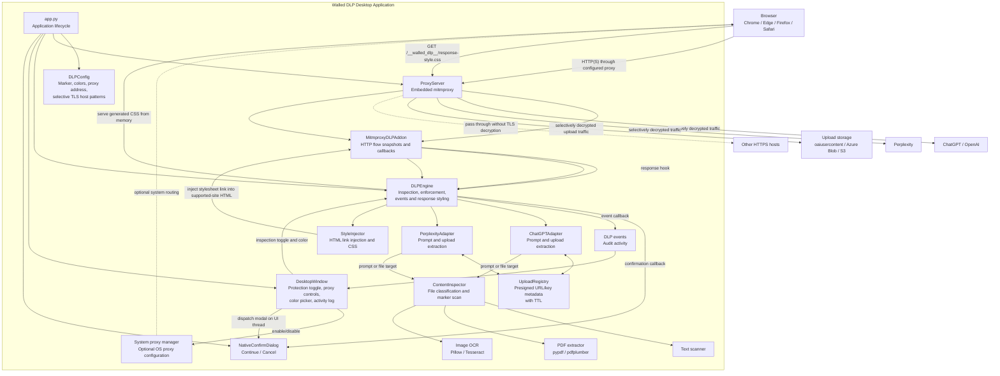
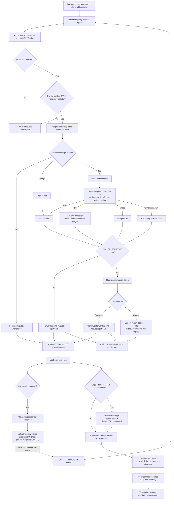

# Walled DLP Architecture Diagrams

This file contains the editable Mermaid source and rendered SVGs for the Walled DLP desktop application's architecture and data flow. The diagrams reflect the current implementation: response styling is injected through a same-origin stylesheet, and the proxy leaves website Content Security Policy headers unchanged.

## Complete Architecture

## Data Flow

